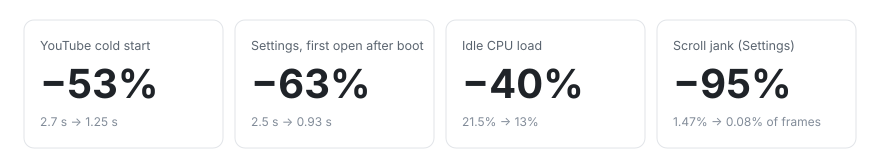
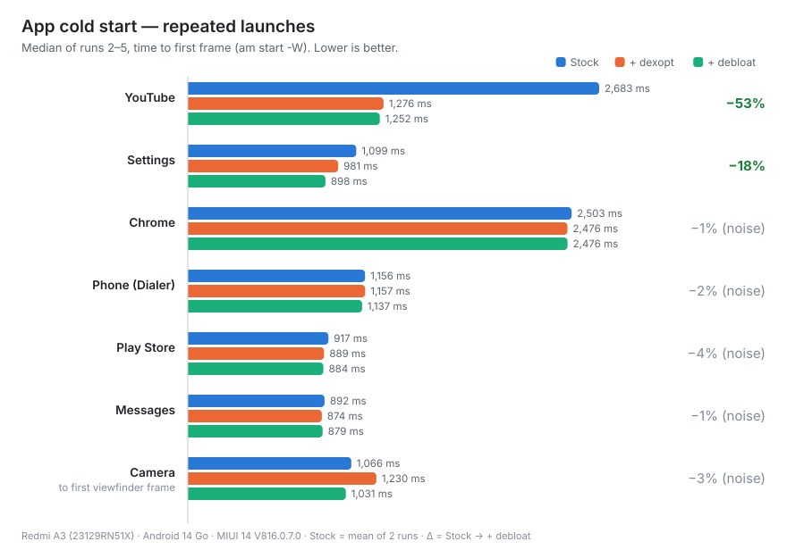
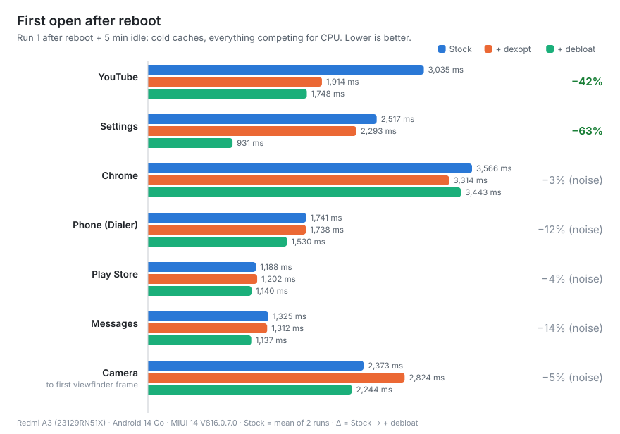
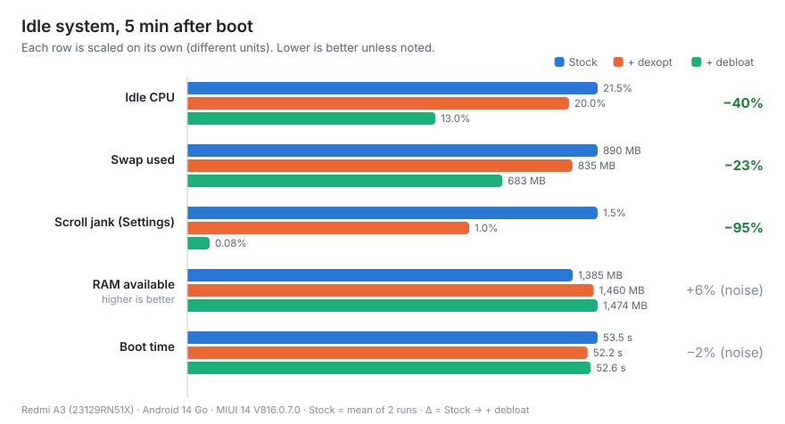
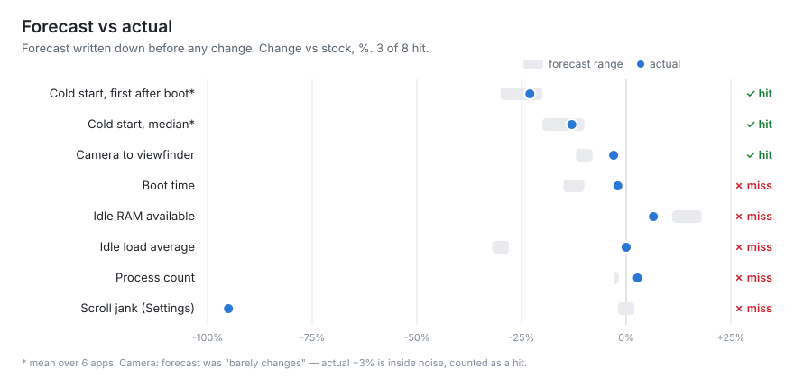

# Redmi A3 optimization, measured

Root-free ADB optimization of a budget Android phone, with a reproducible benchmark before and after every step, and a forecast written down *before* touching anything.

<picture>
  <source media="(prefers-color-scheme: dark)" srcset="docs/charts/hero-dark.svg">
  
</picture>

## Why

I work with developers and need a cheap phone to test Android apps on. The Redmi A3 does the job, but it lagged from the day I bought it, and it was still lagging a year later. Instead of "debloat and hope", I wanted numbers: what actually makes it faster, by how much, and what is placebo.

> [!WARNING]
> This was done on a **test phone** with nothing important on it. It has **not** been tested on a daily-driver phone with personal data, banking apps or work profiles. Everything here is reversible, but you use it **at your own risk**.

## Results

Stock → after compiling apps (`dexopt`) → after removing 35 preinstalled packages (`debloat`). "Stock" is the mean of two separate runs; changes smaller than the measured run-to-run noise are marked *(noise)*.

<picture>
  <source media="(prefers-color-scheme: dark)" srcset="docs/charts/cold-start-median-dark.svg">
  
</picture>

<picture>
  <source media="(prefers-color-scheme: dark)" srcset="docs/charts/cold-start-first-dark.svg">
  
</picture>

<picture>
  <source media="(prefers-color-scheme: dark)" srcset="docs/charts/idle-dark.svg">
  
</picture>

**What actually helped**

- **Compiling apps was the biggest single win.** YouTube, Settings and the MIUI camera were in `status=verify` (not compiled, running on the interpreter and JIT). After `bg-dexopt-job`, YouTube launches twice as fast. Check `adb shell dumpsys package dexopt` first on any laggy phone.
- **Debloating fixed the background.** Idle CPU −40%, swap −207 MB, Settings scroll almost jank-free, and the first open after a reboot got much faster (less competition for CPU and storage).
- **Apps that were already compiled didn't change.** Chrome, Play Store, Phone and Messages stay within noise.
- **More optimization is not always better.** Force-compiling the camera fully (`-m speed`) made it **15% slower** (bigger code to load on slow storage and 3 GB RAM). I rolled it back.

## Test setup

| | |
|---|---|
| Device | Redmi A3, model 23129RN51X (`blue`), MediaTek Helio G36, 3 GB RAM + 3 GB zram |
| Software | Android 14 Go edition, MIUI 14 (V816.0.7.0.UGRMIXM), not rooted, bootloader locked |
| Each run | reboot → 5 min idle untouched → measurements, on USB power, same Wi-Fi |
| Cold start | `am start -W -S`, 5 launches per app: run 1 = first open after boot, runs 2–5 → median |
| Camera | launch → first viewfinder frame, from logcat (`startPreview2firstFrame`) |
| Jank | 20 scripted swipes, then `dumpsys gfxinfo` (janky frames %, p90) |
| Idle | `/proc/meminfo`, `dumpsys cpuinfo`, process and service counts |
| Noise (two stock runs) | medians ±5%, first-open ±16%, idle metrics ±7% |

Raw summaries are in [`results/`](results), the full methodology log, including every mistake, is in [JOURNAL.md](JOURNAL.md).

## Forecast vs actual

Before changing anything I wrote down what I expected. 3 of 8 hit:

<picture>
  <source media="(prefers-color-scheme: dark)" srcset="docs/charts/forecast-dark.svg">
  
</picture>

User-facing metrics (app launch) were predicted well. System metrics were not:
- **Load average is a bad idle metric on Android.** It stayed at 12.9 on every run while idle CPU dropped 40%. Linux counts tasks waiting on I/O and kernel threads in it, so with 800+ processes it barely moves.
- **Freed RAM goes to swap first.** "Available" RAM grew only by 90 MB, but swap dropped by 207 MB. Watch both.

## Do it yourself

Requirements: Windows PowerShell 5.1+, [Android platform-tools](https://developer.android.com/tools/releases/platform-tools) (`adb` in PATH), USB debugging enabled. On Xiaomi also enable **USB debugging (Security settings)**, otherwise `pm` commands are refused.

```powershell
cd scripts

# 1. Baseline. Run it twice to see your noise level.
.\bench.ps1 -Label stock-1 -Reboot -Pin 1234
.\bench.ps1 -Label stock-2 -Reboot -Pin 1234

# 2. Compile apps by usage profile (takes ~10 min on this phone), then measure
adb shell cmd package bg-dexopt-job
.\bench.ps1 -Label after-dexopt -Reboot -Pin 1234

# 3. Remove the packages in debloat-list.txt (edit the list first!), then measure
.\debloat.ps1
.\bench.ps1 -Label after-debloat -Reboot -Pin 1234

# 4. Compare
.\compare.ps1 stock-1 stock-2 after-dexopt after-debloat
```

A full run takes about 15 minutes. Don't touch the phone while it runs.

**About `-Pin`.** With a lock-screen PIN, Android keeps user data encrypted after a reboot until the first unlock (Direct Boot), so most apps don't start and idle metrics look far better than in real life. `-Pin` removes the PIN at the start of the run and restores it at the end, even if the run fails. **Android deletes enrolled fingerprints and face unlock when the PIN is removed**, so you'll have to add them again. Without a PIN, skip the parameter.

**Rollback.** Everything is removed with `pm uninstall --user 0`: the APKs stay on the system partition.

```powershell
.\debloat.ps1 -Restore                       # bring back everything in the list
adb shell cmd package install-existing <pkg> # or a single package
adb shell cmd package compile --reset <pkg>  # undo a manual compile
```

A factory reset also brings everything back.

## What was removed

35 packages, the full list with a one-line explanation each is in [`scripts/debloat-list.txt`](scripts/debloat-list.txt):

- **MIUI ads and analytics:** analytics, the silent partner-app auto-installer, GetApps, Games, ShareMe, Mi Store, wallpaper carousel, App Vault, Cleaner, Mi Browser, Mi Music, Mi Video, Themes, bug report, MediaTek debug logger.
- **Facebook preinstall stubs** (app manager, services, system).
- **Google extras:** Digital Wellbeing (~107 MB resident), YouTube Music, Google TV, Meet, Google One, Google Home, Android Auto, Wallet, TalkBack, Switch Access, Feedback, and, on this test phone only, the Google app, Gmail, Maps, Drive and Photos.

**Kept on purpose:** launcher, keyboard, Phone, Messages, Play Store and Play Services, camera, emergency alerts, Family Link, all user-installed apps. Animations were already at 0.5x before the baseline, so they're not part of the comparison.

Removing the Google app removes the Google search bar from the home screen. Removing `com.xiaomi.discover` stops updates of MIUI system apps.

## Pitfalls I hit while measuring

Each one would have produced a wrong number. Details in [JOURNAL.md](JOURNAL.md).

1. **The camera "opened" in 266 ms**, although it felt like the slowest app. A permission dialog sat on top of it, and `am start -W` was measuring the dialog. Even without it, `am start -W` stops at the first window frame, not the viewfinder, so the camera got its own logcat-based metric.
2. **YouTube reported no launch time.** Its activity is `Shell$HomeActivity`, and the device shell expanded `$HomeActivity` as an empty variable. Quote component names.
3. **The first baseline looked too good** (31 MB swap vs 890 MB in reality): the PIN kept apps from starting (Direct Boot, see above).
4. **Auto-typing the PIN failed after reboot three times.** The MIUI lock screen dozes off within a second between separate `adb` calls. I had only tested the unlock from a short sleep, not in the real "reboot + 5 min idle" scenario.

## License

[MIT](LICENSE). Not affiliated with Xiaomi or Google.
